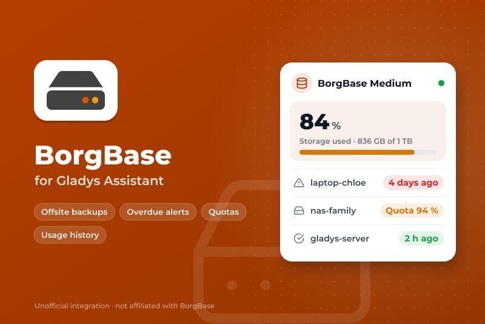
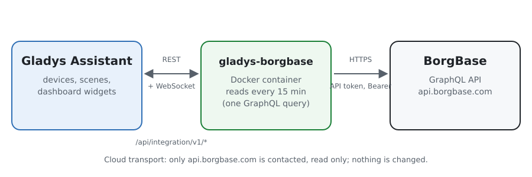
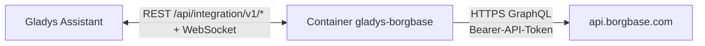
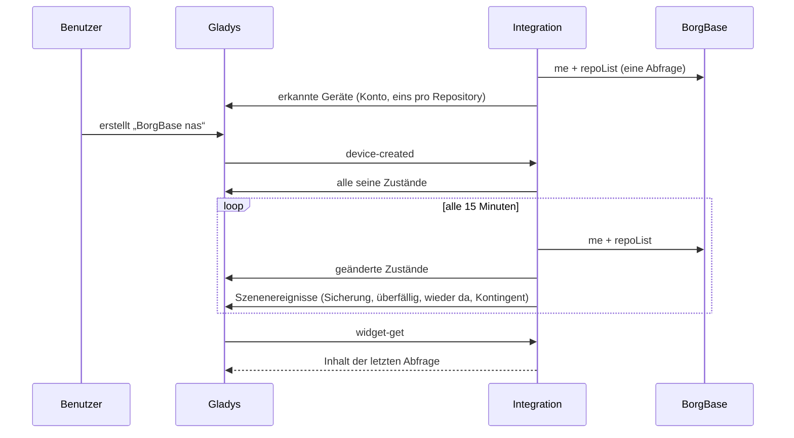
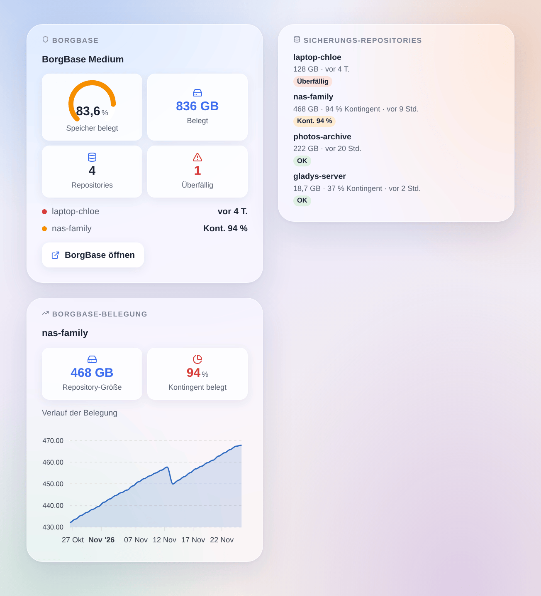
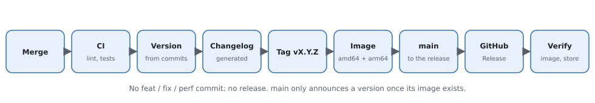

# Gladys BorgBase

[English](README.md) · [Français](README.fr.md) · **Deutsch** · [Español](README.es.md)

[](LICENSE)
[](https://github.com/William-De71/gladys-borgbase/releases)
[](https://github.com/William-De71/gladys-borgbase/actions/workflows/release.yml)
[](https://gladysassistant.com)



Externe Integration für [Gladys Assistant](https://gladysassistant.com) und **[BorgBase](https://www.borgbase.com)**: Überwache die Sicherungs-Repositories deines Kontos in Gladys und lass dich von deinen Szenen warnen, wenn keine Sicherung mehr ankommt oder ein Kontingent voll wird. Sie liest die offizielle GraphQL-API von BorgBase mit einem Read-Only-API-Token.

## Funktionen

- **Ein Gerät pro Repository**: Größe, Kontingent belegt, Zeit seit der letzten Sicherung; und **eins für das Konto**: belegter Speicher, Speicherlimit belegt, Repositories, überfällige Sicherungen.
- **Überfällige Sicherungen** erkannt über die BorgBase-Überwachung jedes Repositorys oder eine eigene Frist.
- **4 Szenenauslöser**, **2 Szenenaktionen** und **3 Dashboard-Widgets** (unten).
- Nur lesend: Ein Read-Only-Token reicht, an BorgBase wird nie etwas geändert. Ein Konfigurationsknopf testet das Token.
- Überall vier Sprachen: Englisch, Französisch, Deutsch, Spanisch.

## Funktionsweise





Standardmäßig alle 15 Minuten (300 bis 3.600 Sekunden) sendet die Integration eine einzige GraphQL-Abfrage: das Konto (`me`: Belegung, Speicherlimit, Tarif, Mehrverbrauchsrechnung) und jedes Repository (`repoList`: Größe und Kontingent in dezimalen MB, letzter Schreibvorgang, BorgBase-Überwachung). Jede Abfrage wird mit der vorherigen verglichen, um die Szenen auszulösen; die erste ist eine Referenz und löst nichts aus.



### Transport

Nur Cloud (`"transports": ["cloud"]`): Der Katalog zeigt das Cloud-Badge. Nur `api.borgbase.com` wird über HTTPS mit deinem Token kontaktiert; deine Sicherungen laufen nie über Gladys.

## Geräte und Funktionen

| Gerät      | Funktion                        | Kategorie / Typ          | Einheit |
| ---------- | ------------------------------- | ------------------------ | ------- |
| Repository | Repository-Größe                | `data/size`              | GB      |
| Repository | Kontingent belegt               | `level-sensor/decimal`   | %       |
| Repository | Zeit seit der letzten Sicherung | `duration/decimal`       | h       |
| Konto      | Belegter Speicher               | `data/size`              | GB      |
| Konto      | Speicherlimit belegt            | `level-sensor/decimal`   | %       |
| Konto      | Repositories, davon überfällig  | `counter-sensor/integer` |         |

`should_poll: false`: Die Integration liest BorgBase mit ihrem eigenen Timer. Externe IDs beruhen auf den BorgBase-IDs (der 8-stelligen Repository-ID, der Konto-ID): Ein umbenanntes Repository behält sein Gerät. Ein Wert, den BorgBase nicht liefert (kein Kontingent, nie gesichert), wird nicht veröffentlicht, nie auf 0 gesetzt.

## Szenenauslöser, Aktionen und Widgets



**Auslöser** (Filter: das Gerät)

- **Neue Sicherung**: In ein Repository wurde geschrieben (auch ein Prune oder eine Komprimierung).
- **Sicherung überfällig**: keine neue Sicherung innerhalb der Frist des Repositorys.
- **Sicherungen wieder da**: Ein überfälliges Repository hat wieder eine Sicherung erhalten.
- **Kontingentstufe erreicht**: Das Kontingent eines Repositorys oder das Speicherlimit des Kontos erreicht 80, 90 oder 100 % (Filter auf Stufe und Bereich).

Jedes Ereignis enthält das Gerät, den Repository-Namen, seine Größe und einen Satz `summary` für eine Nachricht.

**Aktionen**: ein Repository lesen (Status, Größe, Kontingent, Stunden seit der letzten Sicherung, `summary`) und das Konto lesen (Tarif, Belegung, Speicherlimit, überfällige Repositories, `summary`).

**Widgets**: **BorgBase** (Speicheranzeige, Belegung, Repositories, überfällige, offene Punkte, Link), **Sicherungs-Repositories** (ein Badge pro Repository: OK, überfällig, nie, Kontingent) und **BorgBase-Belegung** (der Größenverlauf, den Gladys speichert, eines Repositorys oder des Kontos).

**Beispiele**

- Wenn **eine Sicherung überfällig ist** → eine Benachrichtigung auf dein Handy mit dem `summary`.
- Wenn **das Konto 90 %** seines Speicherlimits erreicht → eine Nachricht, um an den Tarif zu denken.
- Jeden Montag um 9 Uhr → **das Konto lesen** und seinen `summary` per E-Mail senden.

## Voraussetzungen

- Gladys Assistant **5.3.0** oder neuer (Katalog-Schlüsselwörter). Ältere Instanzen können die Integration nicht installieren.
- Ein BorgBase-Konto und ein API-Token mit der Berechtigung **Read Only** (Account → API).

## Installation

- **Aus dem Store** von Gladys (Integrationen → Externe Integrationen), mit einem Klick, sobald indexiert.
- **Über die URL des Repositorys**: `https://github.com/William-De71/gladys-borgbase`.
- **Entwicklermodus**: Baue das Image lokal (`docker build -t gladys-borgbase .`) und installiere es aus Gladys.

## Konfiguration

| Feld                      | Standard    | Zweck                                                              |
| ------------------------- | ----------- | ------------------------------------------------------------------ |
| API-Token                 | —           | Ein Read-Only-Token (geheim).                                      |
| Überfällig nach (Stunden) | 26          | Für Repositories ohne BorgBase-Überwachung; 1 bis 2.160 Stunden.   |
| Abfrageintervall (s)      | 900         | 300 bis 3.600 Sekunden; auch die Reaktionszeit der Szenenauslöser. |
| Sprache der Texte         | automatisch | Gerätenamen, Zusammenfassungen und Ausgaben der Szenen.            |

## Verwendung

1. Öffne auf borgbase.com **Account → API** und erstelle ein Token mit der Berechtigung **Read Only**.
2. Füge es in die Konfiguration ein, passe die Frist an, wenn deine Sicherungen nicht täglich laufen, speichere und drücke **Verbindung testen**.
3. Erstelle im Reiter **Erkennung** das Kontogerät und die Repository-Geräte.
4. Füge die Widgets **BorgBase**, **Sicherungs-Repositories** und **BorgBase-Belegung** hinzu und baue Szenen mit den Auslösern oben.

## Entwicklung

```bash
npm install
npm test                       # node --test, ohne Netzwerkzugriff
npm run lint && npm run format:check
npx github:GladysAssistant/integration-store . --skip-image-check
scripts/build-cover.sh         # cover.jpg aus docs/assets/cover.svg
docs/illustrations/render.sh   # docs/assets/widgets.<sprache>.png
node .github/scripts/release.mjs next
```

Lokal liest das SDK `GLADYS_HOST_API_URL`, `GLADYS_INTEGRATION_TOKEN` und `GLADYS_INTEGRATION_SELECTOR`; `DEBUG=gladys-integration-sdk` zeigt die Logs des SDK. Die Tests bedienen einen falschen GraphQL-Endpunkt (`test/helpers/fixtures.js`) nach dem [Live-Schema](https://api.borgbase.com/graphql) und seinen Antworten. Die Regeln des Projekts stehen in [CLAUDE.md](CLAUDE.md).

## Release-Prozess



Jeder Merge auf `main` startet die CI und berechnet dann die Version aus den [Conventional Commits](https://www.conventionalcommits.org/) seit dem letzten Tag: `feat` → Minor, `fix` / `perf` → Patch, `!` oder `BREAKING CHANGE` → Major (vor 1.0.0 ein Minor); `docs`, `chore`, `ci`, `test`, `style`, `refactor`, `build` allein veröffentlichen nichts. Der Changelog-Abschnitt wird erzeugt, der Tag gepusht, das Multi-Architektur-Image gebaut, dann erhält `main` den Release-Commit, das GitHub-Release wird erstellt und ein letzter Job prüft das öffentliche Image, den Store-Validator und das Topic.

- Der Titel des Pull Requests wird zum Squash-Commit und dann zur Changelog-Zeile: Schreibe ihn auf Englisch, für den Benutzer (`pr-title.yml` prüft ihn). Bearbeite `CHANGELOG.md` nie von Hand.
- 1.0.0 ist eine Entscheidung: Actions → Release → Run workflow mit `release-as: 1.0.0`. `dry-run` zeigt Version und Notizen, ohne etwas zu veröffentlichen.
- **Geschützter Branch**: Rulesets verlangen einen Pull Request auf `main` und sperren die Tags `v*`; nur der Maintainer und Deploy Keys kommen durch. Das Release pusht mit dem Deploy Key der Umgebung `release` (Secret `RELEASE_DEPLOY_KEY`, nur `main`): Ein Lauf aus einem anderen Branch erhält ihn nie. `build.yml` und `github-release.yml` starten nicht bei einem Tag: Das Release ruft sie auf, oder starte sie von Hand (Actions → Run workflow, mit `version` für das Image), um ein Release abzuschließen.
- Mache nach dem ersten Release das Paket auf `ghcr.io` öffentlich (Package settings → Change visibility), sonst kann Gladys es nicht laden.

## Fehlerbehebung

Siehe [docs/de.md](docs/de.md#fehlerbehebung). Melde Probleme mit den Versionen von Gladys und der Integration und den Logs der Integration (nie dein Token).

## Mitwirken

Issues und Pull Requests sind willkommen. Führe `npm run format:check && npm run lint && npm test` aus, bevor du einen Pull Request öffnest, und ändere keine externe ID und keinen gespeicherten Schlüssel (siehe [CLAUDE.md](CLAUDE.md)).

## Sicherheit

Siehe [SECURITY.md](SECURITY.md): Melde Schwachstellen vertraulich. Das Token ist ein `secret`-Feld von Gladys, wird nur an `api.borgbase.com` in einem Bearer-Header über HTTPS gesendet und nie in die Logs geschrieben. Ein Read-Only-Token kann an deinem Konto nichts ändern; die Abfrage verlangt weder SSH-Schlüssel noch Passwort noch Adresse. Die Integration läuft als Nicht-Root-Benutzer in ihrem Container.

## Kommende Screenshots

Die Bilder oben sind Illustrationen, keine Screenshots. Echte Screenshots kommen nach `docs/assets/screenshots/` (PNG, 1280 × 800): `configuration.png`, `discovery.png`, `device.png`, `scene.png`.

## Lizenz

[Apache License 2.0](LICENSE) — siehe auch [NOTICE](NOTICE). BorgBase ist ein Dienst der BorgBase Ltd.; diese Integration ist nicht mit BorgBase verbunden. Dank an die Dokumentation und das SDK von Gladys und an BorgBase für sein offenes GraphQL-Schema.
