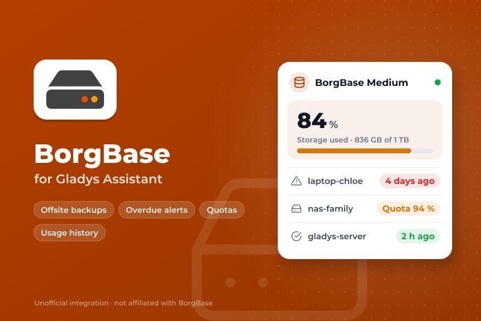
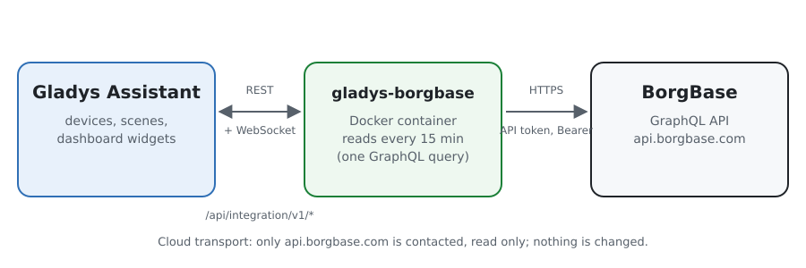
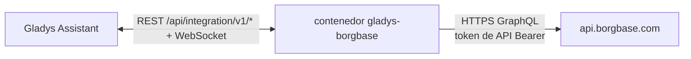
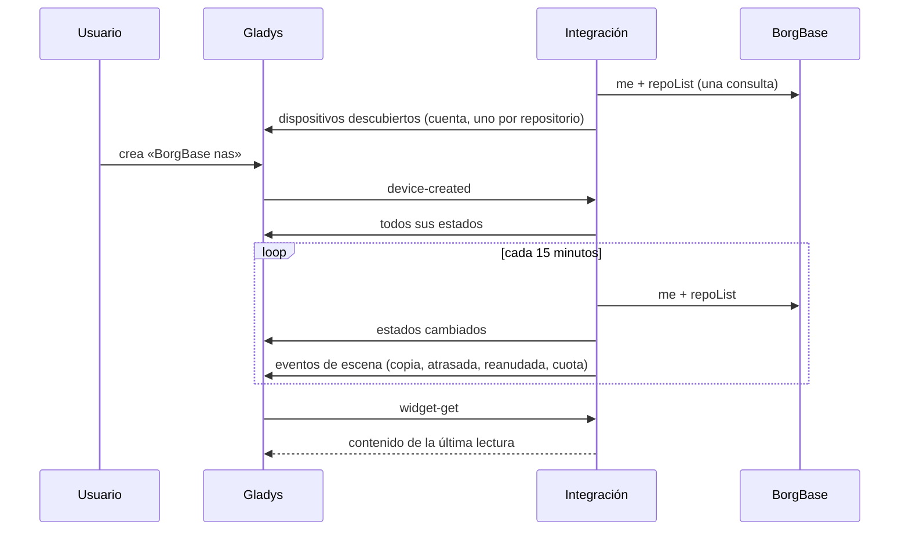
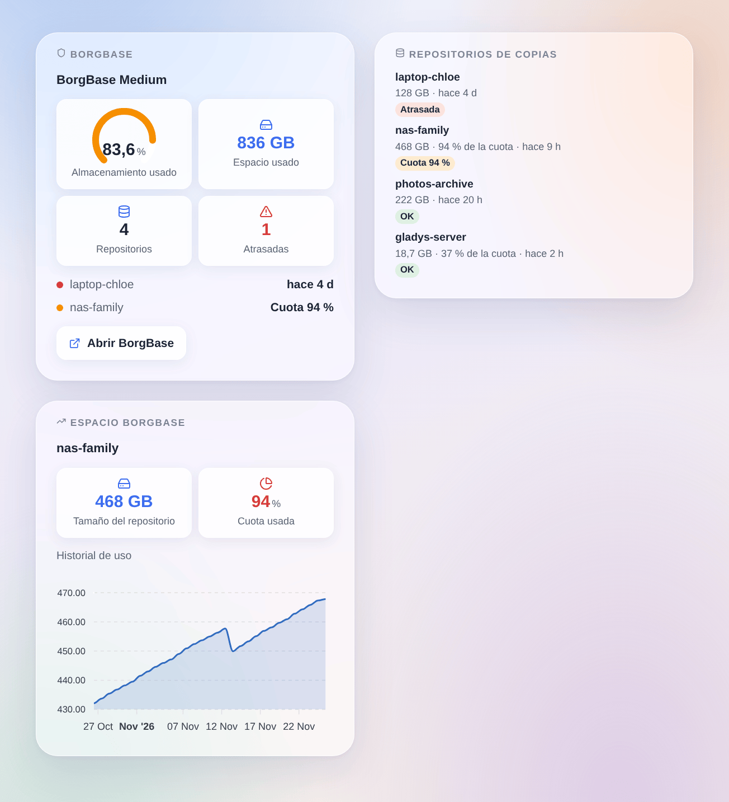

# Gladys BorgBase

[English](README.md) · [Français](README.fr.md) · [Deutsch](README.de.md) · **Español**

[](LICENSE)
[](https://github.com/William-De71/gladys-borgbase/releases)
[](https://github.com/William-De71/gladys-borgbase/actions/workflows/release.yml)
[](https://gladysassistant.com)



Integración externa de [Gladys Assistant](https://gladysassistant.com) para **[BorgBase](https://www.borgbase.com)**: vigile en Gladys los repositorios de copias de su cuenta y reciba avisos de sus escenas cuando una copia deja de llegar o una cuota se llena. Lee la API GraphQL oficial de BorgBase con un token de API Read Only.

## Funcionalidades

- **Un dispositivo por repositorio**: tamaño, cuota usada, tiempo desde la última copia; y **uno para la cuenta**: espacio usado, límite de almacenamiento usado, repositorios, copias atrasadas.
- **Copias atrasadas** detectadas con la supervisión de BorgBase de cada repositorio, o un plazo propio.
- **4 disparadores de escena**, **2 acciones de escena** y **3 widgets de panel** (más abajo).
- Solo lectura: basta con un token Read Only, nunca se modifica nada en BorgBase. Un botón de configuración prueba el token.
- Cuatro idiomas en todas partes: inglés, francés, alemán, español.

## Funcionamiento





Cada 15 minutos por defecto (de 300 a 3600 segundos), la integración envía una sola consulta GraphQL: la cuenta (`me`: espacio, límite de almacenamiento, plan, factura de exceso) y cada repositorio (`repoList`: tamaño y cuota en MB decimales, última escritura, supervisión de BorgBase). Cada lectura se compara con la anterior para disparar las escenas; la primera es una referencia y no dispara nada.



### Transporte

Solo nube (`"transports": ["cloud"]`): el catálogo muestra la insignia de nube. Solo se contacta `api.borgbase.com`, por HTTPS, con su token; sus copias nunca pasan por Gladys.

## Dispositivos y funcionalidades

| Dispositivo | Funcionalidad                    | Categoría / tipo         | Unidad |
| ----------- | -------------------------------- | ------------------------ | ------ |
| Repositorio | Tamaño del repositorio           | `data/size`              | GB     |
| Repositorio | Cuota usada                      | `level-sensor/decimal`   | %      |
| Repositorio | Tiempo desde la última copia     | `duration/decimal`       | h      |
| Cuenta      | Espacio usado                    | `data/size`              | GB     |
| Cuenta      | Límite de almacenamiento usado   | `level-sensor/decimal`   | %      |
| Cuenta      | Repositorios, de ellos atrasados | `counter-sensor/integer` |        |

`should_poll: false`: la integración lee BorgBase con su propio temporizador. Los identificadores externos se basan en los de BorgBase (el identificador de 8 caracteres del repositorio, el de la cuenta): renombrar un repositorio conserva su dispositivo. Un valor que BorgBase no da (sin cuota, nunca copiado) no se publica, nunca se pone a 0.

## Disparadores, acciones de escena y widgets



**Disparadores** (filtro: el dispositivo)

- **Nueva copia**: se escribió en un repositorio (una purga o una compactación también cuentan).
- **Copia atrasada**: ninguna copia nueva en el plazo del repositorio.
- **Copias reanudadas**: un repositorio atrasado ha vuelto a recibir una copia.
- **Nivel de cuota alcanzado**: la cuota de un repositorio o el límite de almacenamiento de la cuenta alcanza el 80, 90 o 100 % (filtros por nivel y ámbito).

Cada evento lleva el dispositivo, el nombre del repositorio, su tamaño y una frase `summary` lista para un mensaje.

**Acciones**: leer un repositorio (estado, tamaño, cuota, horas desde la última copia, `summary`) y leer la cuenta (plan, espacio, límite de almacenamiento, repositorios atrasados, `summary`).

**Widgets**: **BorgBase** (indicador de almacenamiento, espacio, repositorios, atrasados, lo que requiere atención, enlace), **Repositorios de copias** (una insignia por repositorio: OK, atrasada, nunca, cuota) y **Espacio BorgBase** (el historial del tamaño que guarda Gladys, de un repositorio o de la cuenta).

**Ejemplos**

- Cuando **una copia está atrasada** → una notificación en su teléfono con el `summary`.
- Cuando **la cuenta alcanza el 90 %** de su límite de almacenamiento → un mensaje para pensar en el plan.
- Cada lunes a las 9 → **leer la cuenta** y enviar su `summary` por correo.

## Requisitos

- Gladys Assistant **5.3.0** o posterior (palabras clave del catálogo). Las instancias más antiguas no pueden instalar la integración.
- Una cuenta BorgBase y un token de API con el permiso **Read Only** (Account → API).

## Instalación

- **Desde la tienda** de Gladys (Integraciones → Integraciones externas), con un clic, una vez indexada.
- **Desde la URL del repositorio**: `https://github.com/William-De71/gladys-borgbase`.
- **Modo desarrollador**: construya la imagen en local (`docker build -t gladys-borgbase .`) e instálela desde Gladys.

## Configuración

| Campo                       | Por defecto | Función                                                                   |
| --------------------------- | ----------- | ------------------------------------------------------------------------- |
| Token de API                | —           | Un token Read Only (secreto).                                             |
| Atrasada después de (horas) | 26          | Para los repositorios sin supervisión de BorgBase; de 1 a 2160 horas.     |
| Intervalo de lectura (s)    | 900         | De 300 a 3600 segundos; también el retardo de los disparadores de escena. |
| Idioma de los textos        | automático  | Nombres de los dispositivos, resúmenes y salidas de las escenas.          |

## Uso

1. En borgbase.com, abra **Account → API** y cree un token con el permiso **Read Only**.
2. Péguelo en la configuración, ajuste el plazo si sus copias no son diarias, guarde y pulse **Probar la conexión**.
3. En la pestaña **Descubrimiento**, cree el dispositivo de la cuenta y los de los repositorios.
4. Añada los widgets **BorgBase**, **Repositorios de copias** y **Espacio BorgBase**, y cree escenas con los disparadores de arriba.

## Desarrollo

```bash
npm install
npm test                       # node --test, sin tocar nunca la red
npm run lint && npm run format:check
npx github:GladysAssistant/integration-store . --skip-image-check
scripts/build-cover.sh         # cover.jpg a partir de docs/assets/cover.svg
docs/illustrations/render.sh   # docs/assets/widgets.<idioma>.png
node .github/scripts/release.mjs next
```

En local, el SDK lee `GLADYS_HOST_API_URL`, `GLADYS_INTEGRATION_TOKEN` y `GLADYS_INTEGRATION_SELECTOR`; `DEBUG=gladys-integration-sdk` muestra los registros del SDK. Las pruebas sirven un falso punto de acceso GraphQL (`test/helpers/fixtures.js`) calcado del [esquema en línea](https://api.borgbase.com/graphql) y sus respuestas. Las reglas del proyecto están en [CLAUDE.md](CLAUDE.md).

## Proceso de publicación


Cada fusión en `main` lanza la CI y luego calcula la versión a partir de los [Conventional Commits](https://www.conventionalcommits.org/) desde la última etiqueta: `feat` → menor, `fix` / `perf` → parche, `!` o `BREAKING CHANGE` → mayor (una menor antes de 1.0.0); `docs`, `chore`, `ci`, `test`, `style`, `refactor`, `build` solos no publican nada. Se genera la sección del changelog, se envía la etiqueta, se construye la imagen multiarquitectura, luego `main` recibe el commit de publicación, se crea la GitHub Release y un último job comprueba la imagen pública, el validador de la tienda y el topic.

- El título de la pull request se convierte en el commit squash y luego en la línea del changelog: escríbalo en inglés, para el usuario (`pr-title.yml` lo comprueba). Nunca edite `CHANGELOG.md` a mano.
- La 1.0.0 es una decisión: Actions → Release → Run workflow con `release-as: 1.0.0`. `dry-run` muestra la versión y las notas sin publicar nada.
- **Rama protegida**: los rulesets exigen una pull request en `main` y bloquean las etiquetas `v*`; solo pasan el mantenedor y las deploy keys. La publicación envía con la deploy key del entorno `release` (secreto `RELEASE_DEPLOY_KEY`, solo `main`): una ejecución desde otra rama nunca la obtiene. `build.yml` y `github-release.yml` no arrancan con una etiqueta: la publicación los llama, o láncelos a mano (Actions → Run workflow, con `version` para la imagen) para terminar una publicación.
- Tras la primera publicación, haga público el paquete de `ghcr.io` (Package settings → Change visibility), o Gladys no podrá descargarlo.

## Solución de problemas

Vea [docs/es.md](docs/es.md#solución-de-problemas). Informe de los problemas con las versiones de Gladys y de la integración, y los registros de la integración (nunca su token).

## Contribuir

Las issues y pull requests son bienvenidas. Ejecute `npm run format:check && npm run lint && npm test` antes de abrir una pull request, y no cambie ningún identificador externo ni ninguna clave guardada (vea [CLAUDE.md](CLAUDE.md)).

## Seguridad

Vea [SECURITY.md](SECURITY.md): informe de las vulnerabilidades en privado. El token es un campo `secret` de Gladys, enviado solo a `api.borgbase.com` en un encabezado Bearer por HTTPS, y nunca escrito en los registros. Un token Read Only no puede cambiar nada en su cuenta; la consulta no pide ni clave SSH, ni contraseña, ni dirección. La integración se ejecuta con un usuario no root, en su contenedor.

## Capturas por venir

Las imágenes de arriba son ilustraciones, no capturas de pantalla. Las capturas reales irán en `docs/assets/screenshots/` (PNG, 1280 × 800): `configuration.png`, `discovery.png`, `device.png`, `scene.png`.

## Licencia

[Licencia Apache 2.0](LICENSE) — vea también [NOTICE](NOTICE). BorgBase es un servicio de BorgBase Ltd.; esta integración no está afiliada a BorgBase. Gracias a la documentación y al SDK de Gladys, y a BorgBase por su esquema GraphQL abierto.
