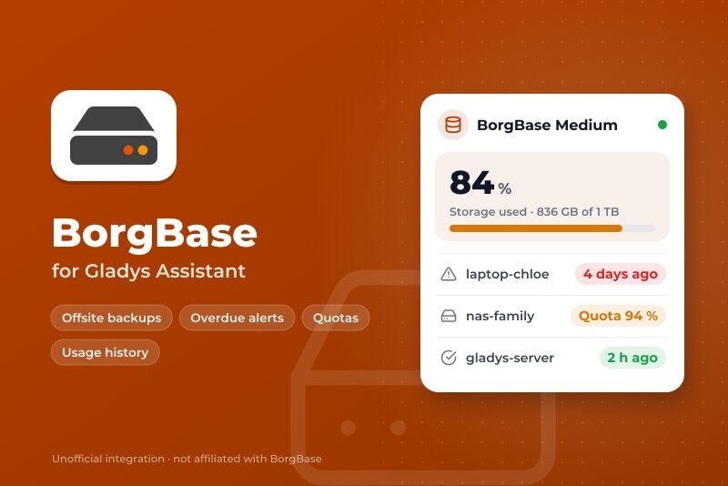
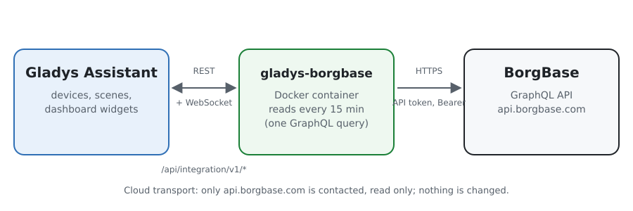
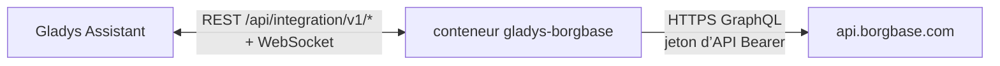
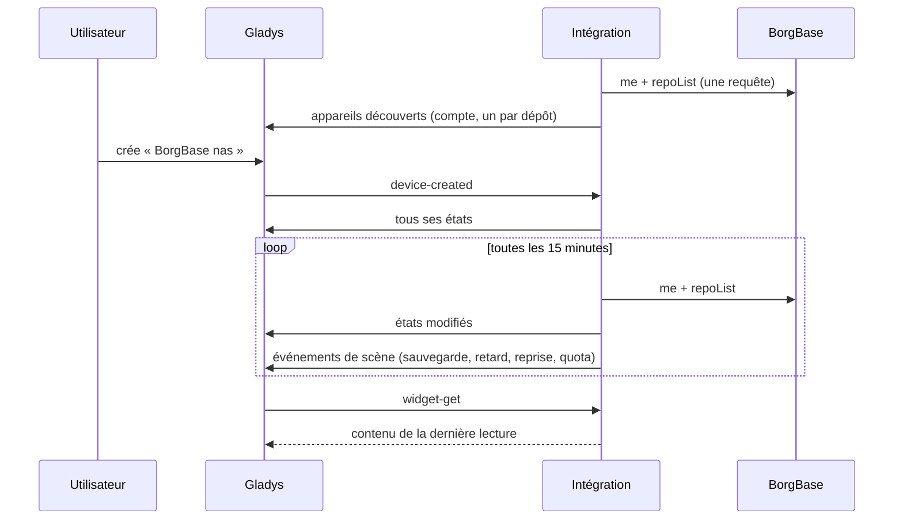
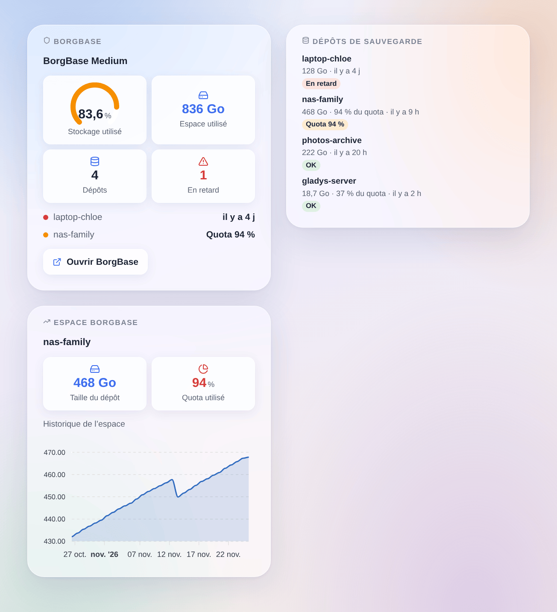

# Gladys BorgBase

[English](README.md) · **Français** · [Deutsch](README.de.md) · [Español](README.es.md)

[](LICENSE)
[](https://github.com/William-De71/gladys-borgbase/releases)
[](https://github.com/William-De71/gladys-borgbase/actions/workflows/release.yml)
[](https://gladysassistant.com)



Intégration externe [Gladys Assistant](https://gladysassistant.com) pour **[BorgBase](https://www.borgbase.com)** : surveillez dans Gladys les dépôts de sauvegarde de votre compte, et soyez prévenu par vos scènes quand une sauvegarde n’arrive plus ou qu’un quota se remplit. Elle lit l’API GraphQL officielle de BorgBase avec un jeton d’API Read Only.

## Fonctionnalités

- **Un appareil par dépôt** : taille, quota utilisé, temps depuis la dernière sauvegarde ; et **un pour le compte** : espace utilisé, limite de stockage utilisée, dépôts, sauvegardes en retard.
- **Sauvegardes en retard** détectées avec la surveillance BorgBase de chaque dépôt, ou un délai à vous.
- **4 déclencheurs de scène**, **2 actions de scène** et **3 widgets de tableau de bord** (plus bas).
- Lecture seule : un jeton Read Only suffit, rien n’est jamais modifié sur BorgBase. Un bouton de configuration teste le jeton.
- Quatre langues partout : anglais, français, allemand, espagnol.

## Fonctionnement





Toutes les 15 minutes par défaut (300 à 3 600 secondes), l’intégration envoie une seule requête GraphQL : le compte (`me` : espace, limite de stockage, offre, facture de dépassement) et chaque dépôt (`repoList` : taille et quota en Mo décimaux, dernière écriture, surveillance BorgBase). Chaque lecture est comparée à la précédente pour déclencher les scènes ; la première sert de référence et ne déclenche rien.



### Transport

Cloud uniquement (`"transports": ["cloud"]`) : le catalogue affiche le badge cloud. Seul `api.borgbase.com` est contacté, en HTTPS, avec votre jeton ; vos sauvegardes ne passent jamais par Gladys.

## Appareils et fonctionnalités

| Appareil | Fonctionnalité                      | Catégorie / type         | Unité |
| -------- | ----------------------------------- | ------------------------ | ----- |
| Dépôt    | Taille du dépôt                     | `data/size`              | Go    |
| Dépôt    | Quota utilisé                       | `level-sensor/decimal`   | %     |
| Dépôt    | Temps depuis la dernière sauvegarde | `duration/decimal`       | h     |
| Compte   | Espace utilisé                      | `data/size`              | Go    |
| Compte   | Limite de stockage utilisée         | `level-sensor/decimal`   | %     |
| Compte   | Dépôts, dont en retard              | `counter-sensor/integer` |       |

`should_poll: false` : l’intégration lit BorgBase avec son propre minuteur. Les identifiants externes reposent sur les identifiants BorgBase (l’identifiant de 8 caractères du dépôt, celui du compte) : renommer un dépôt garde son appareil. Une valeur que BorgBase ne donne pas (pas de quota, jamais sauvegardé) n’est pas publiée, jamais mise à 0.

## Déclencheurs, actions de scène et widgets



**Déclencheurs** (filtre : l’appareil)

- **Nouvelle sauvegarde** : un dépôt a été écrit (un nettoyage ou un compactage compte aussi).
- **Sauvegarde en retard** : aucune nouvelle sauvegarde dans le délai du dépôt.
- **Sauvegardes reprises** : un dépôt en retard a de nouveau reçu une sauvegarde.
- **Seuil de quota atteint** : le quota d’un dépôt ou la limite de stockage du compte atteint 80, 90 ou 100 % (filtres sur le seuil et la portée).

Chaque événement porte l’appareil, le nom du dépôt, sa taille et une phrase `summary` prête pour un message.

**Actions** : lire un dépôt (état, taille, quota, heures depuis la dernière sauvegarde, `summary`) et lire le compte (offre, espace, limite de stockage, dépôts en retard, `summary`).

**Widgets** : **BorgBase** (jauge de stockage, espace, dépôts, retards, points à surveiller, lien), **Dépôts de sauvegarde** (un badge par dépôt : OK, en retard, jamais, quota) et **Espace BorgBase** (l’historique de la taille que garde Gladys, d’un dépôt ou du compte).

**Exemples**

- Quand **une sauvegarde est en retard** → une notification sur votre téléphone avec le `summary`.
- Quand **le compte atteint 90 %** de sa limite de stockage → un message pour penser à l’offre.
- Chaque lundi à 9 h → **lire le compte**, puis envoyer son `summary` par e-mail.

## Prérequis

- Gladys Assistant **5.3.0** ou plus récent (mots-clés du catalogue). Les instances plus anciennes ne peuvent pas installer l’intégration.
- Un compte BorgBase et un jeton d’API avec la permission **Read Only** (Account → API).

## Installation

- **Depuis le store** de Gladys (Intégrations → Intégrations externes), en un clic, une fois indexée.
- **Depuis l’URL du dépôt** : `https://github.com/William-De71/gladys-borgbase`.
- **Mode développeur** : construisez l’image en local (`docker build -t gladys-borgbase .`) et installez-la depuis Gladys.

## Configuration

| Champ                     | Défaut      | Rôle                                                                |
| ------------------------- | ----------- | ------------------------------------------------------------------- |
| Jeton d’API               | —           | Un jeton Read Only (secret).                                        |
| En retard après (heures)  | 26          | Pour les dépôts sans surveillance BorgBase ; de 1 à 2 160 heures.   |
| Intervalle de lecture (s) | 900         | De 300 à 3 600 secondes ; aussi le délai des déclencheurs de scène. |
| Langue des textes         | automatique | Noms des appareils, résumés et sorties des scènes.                  |

## Utilisation

1. Sur borgbase.com, ouvrez **Account → API** et créez un jeton avec la permission **Read Only**.
2. Collez-le dans la configuration, ajustez le délai si vos sauvegardes ne sont pas quotidiennes, enregistrez, puis appuyez sur **Tester la connexion**.
3. Dans l’onglet **Découverte**, créez l’appareil du compte et ceux des dépôts.
4. Ajoutez les widgets **BorgBase**, **Dépôts de sauvegarde** et **Espace BorgBase**, et créez des scènes avec les déclencheurs ci-dessus.

## Développement

```bash
npm install
npm test                       # node --test, sans jamais toucher au réseau
npm run lint && npm run format:check
npx github:GladysAssistant/integration-store . --skip-image-check
scripts/build-cover.sh         # cover.jpg depuis docs/assets/cover.svg
docs/illustrations/render.sh   # docs/assets/widgets.<langue>.png
node .github/scripts/release.mjs next
```

En local, le SDK lit `GLADYS_HOST_API_URL`, `GLADYS_INTEGRATION_TOKEN` et `GLADYS_INTEGRATION_SELECTOR` ; `DEBUG=gladys-integration-sdk` affiche les journaux du SDK. Les tests servent un faux point d’accès GraphQL (`test/helpers/fixtures.js`) calqué sur le [schéma en ligne](https://api.borgbase.com/graphql) et ses réponses. Les règles du projet sont dans [CLAUDE.md](CLAUDE.md).

## Processus de release


Chaque fusion sur `main` lance la CI, puis calcule la version à partir des [Conventional Commits](https://www.conventionalcommits.org/) depuis le dernier tag : `feat` → mineure, `fix` / `perf` → correctif, `!` ou `BREAKING CHANGE` → majeure (une mineure avant 1.0.0) ; `docs`, `chore`, `ci`, `test`, `style`, `refactor`, `build` seuls ne publient rien. La section du changelog est générée, le tag poussé, l’image multi-architecture construite, puis `main` reçoit le commit de release, la GitHub Release est créée et un dernier job vérifie l’image publique, le validateur du store et le topic.

- Le titre de la pull request devient le commit squash, puis la ligne du changelog : écrivez-le en anglais, pour l’utilisateur (`pr-title.yml` le vérifie). N’éditez jamais `CHANGELOG.md` à la main.
- La 1.0.0 est une décision : Actions → Release → Run workflow avec `release-as: 1.0.0`. `dry-run` affiche la version et les notes sans rien publier.
- **Branche protégée** : des rulesets imposent une pull request sur `main` et verrouillent les tags `v*` ; seuls le mainteneur et les deploy keys passent. La release pousse avec la deploy key de l’environnement `release` (secret `RELEASE_DEPLOY_KEY`, `main` seulement) : un run depuis une autre branche ne l’obtient jamais. `build.yml` et `github-release.yml` ne démarrent pas sur un tag : la release les appelle, ou lancez-les à la main (Actions → Run workflow, avec `version` pour l’image) pour finir une release.
- Après la première release, rendez public le package `ghcr.io` (Package settings → Change visibility), sinon Gladys ne peut pas le télécharger.

## Dépannage

Voir [docs/fr.md](docs/fr.md#dépannage). Signalez un problème avec les versions de Gladys et de l’intégration, et les journaux de l’intégration (jamais votre jeton).

## Contribuer

Les issues et pull requests sont bienvenues. Lancez `npm run format:check && npm run lint && npm test` avant d’ouvrir une pull request, et ne changez aucun identifiant externe ni aucune clé stockée (voir [CLAUDE.md](CLAUDE.md)).

## Sécurité

Voir [SECURITY.md](SECURITY.md) : signalez les vulnérabilités en privé. Le jeton est un champ `secret` de Gladys, envoyé seulement à `api.borgbase.com` dans un en-tête Bearer en HTTPS, et jamais écrit dans les journaux. Un jeton Read Only ne peut rien modifier sur votre compte ; la requête ne demande ni clé SSH, ni mot de passe, ni adresse. L’intégration tourne avec un utilisateur non root, dans son conteneur.

## Captures à venir

Les images ci-dessus sont des illustrations, pas des captures d’écran. Les vraies captures iront dans `docs/assets/screenshots/` (PNG, 1280 × 800) : `configuration.png`, `discovery.png`, `device.png`, `scene.png`.

## Licence

[Licence Apache 2.0](LICENSE) — voir aussi [NOTICE](NOTICE). BorgBase est un service de BorgBase Ltd. ; cette intégration n’est pas affiliée à BorgBase. Merci à la documentation et au SDK de Gladys, et à BorgBase pour son schéma GraphQL ouvert.
