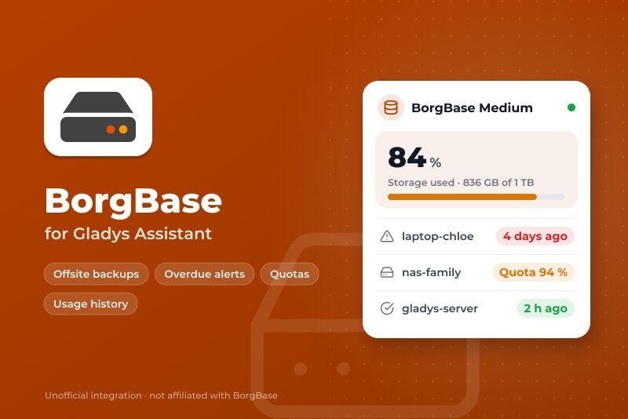
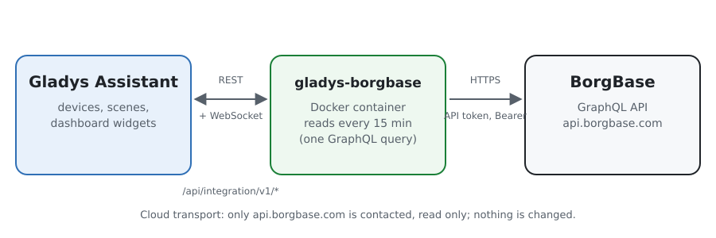
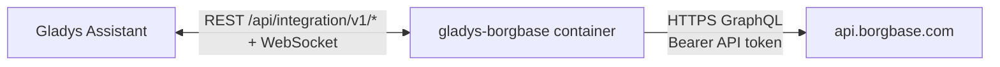
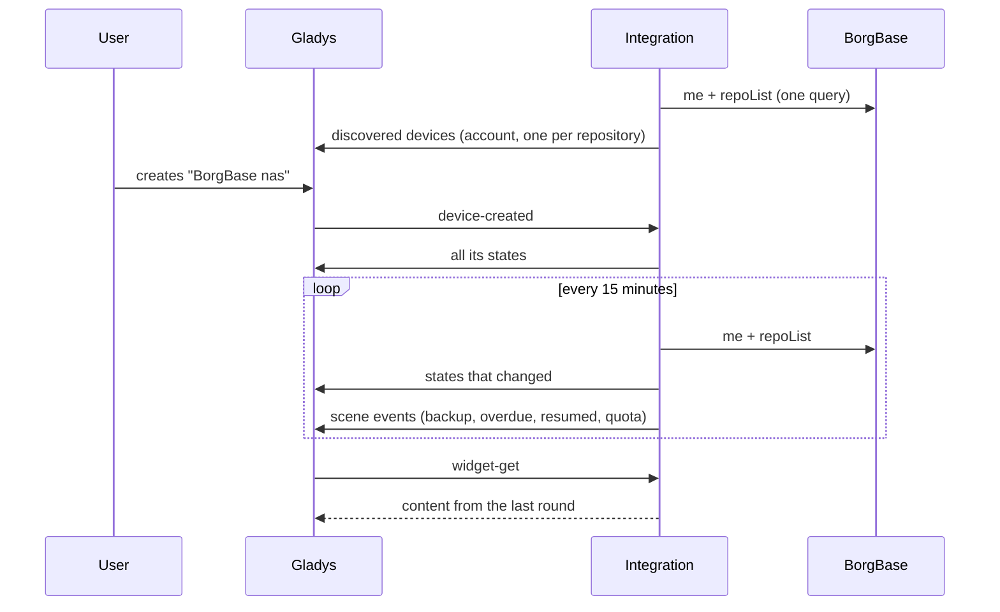
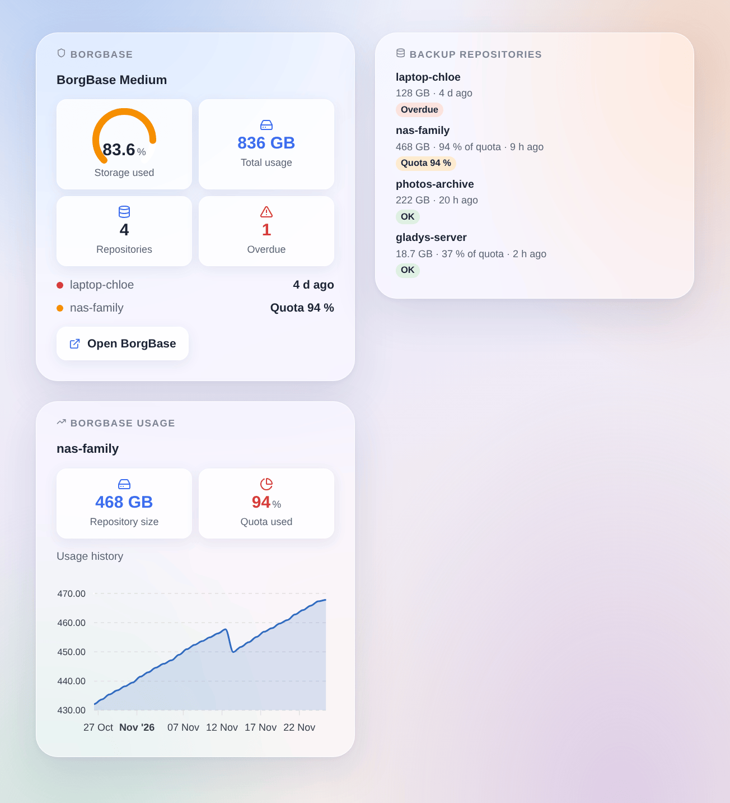

# Gladys BorgBase

**English** · [Français](README.fr.md) · [Deutsch](README.de.md) · [Español](README.es.md)

[](LICENSE)
[](https://github.com/William-De71/gladys-borgbase/releases)
[](https://github.com/William-De71/gladys-borgbase/actions/workflows/release.yml)
[](https://gladysassistant.com)



[Gladys Assistant](https://gladysassistant.com) external integration for **[BorgBase](https://www.borgbase.com)**: watch the backup repositories of your account in Gladys, and get warned by your scenes when a backup no longer arrives or a quota fills up. It reads the official BorgBase GraphQL API with a Read Only API token.

## Features

- **One device per repository**: size, quota used, time since the last backup; and **one for the account**: total usage, storage limit used, repositories, overdue backups.
- **Overdue backups** detected with the BorgBase monitoring of each repository, or a delay of your own.
- **4 scene triggers**, **2 scene actions** and **3 dashboard widgets** (below).
- Read only: a Read Only token is enough, nothing is ever changed on BorgBase. A configuration button tests the token.
- Four languages everywhere: English, French, German, Spanish.

## How it works





Every 15 minutes by default (300 to 3,600 seconds), the integration sends one GraphQL query: the account (`me`: usage, storage limit, plan, overage invoice) and every repository (`repoList`: size and quota in decimal MB, last write, BorgBase monitoring). Each round is compared with the previous one to fire the scene triggers; the first round is a baseline and fires nothing.



### Transport

Cloud only (`"transports": ["cloud"]`): the catalog shows the cloud badge. Only `api.borgbase.com` is contacted, over HTTPS, with your token; your backups never pass through Gladys.

## Devices and features

| Device     | Feature                    | Category / type          | Unit |
| ---------- | -------------------------- | ------------------------ | ---- |
| Repository | Repository size            | `data/size`              | GB   |
| Repository | Quota used                 | `level-sensor/decimal`   | %    |
| Repository | Time since last backup     | `duration/decimal`       | h    |
| Account    | Total usage                | `data/size`              | GB   |
| Account    | Storage limit used         | `level-sensor/decimal`   | %    |
| Account    | Repositories, overdue ones | `counter-sensor/integer` |      |

`should_poll: false`: the integration reads BorgBase on its own timer. External ids are built on the BorgBase ids (the 8-character repository id, the account id): renaming a repository keeps its device. A value BorgBase does not give (no quota, never backed up) is not published, never set to 0.

## Scene triggers, actions and widgets



**Triggers** (filter: the device)

- **New backup**: a repository was written to (a prune or a compaction counts too).
- **Backup overdue**: no new backup within the delay of the repository.
- **Backups resumed**: an overdue repository received a backup again.
- **Quota level reached**: a repository quota or the account storage limit reaches 80, 90 or 100 % (filters on the level and the scope).

Every event carries the device, the repository name, its size and a `summary` sentence ready for a message.

**Actions**: read a repository (status, size, quota, hours since the last backup, `summary`), and read the account (plan, usage, storage limit, overdue repositories, `summary`).

**Widgets**: **BorgBase** (storage gauge, usage, repositories, overdue, what needs attention, link), **Backup repositories** (a badge per repository: OK, overdue, never, quota) and **BorgBase usage** (the size history Gladys keeps of a repository or of the account).

**Examples**

- When **a backup is overdue** → a notification on your phone with the `summary`.
- When **the account reaches 90 %** of its storage limit → a message to think about the plan.
- Every Monday at 9 am → **read the account**, then send its `summary` by e-mail.

## Requirements

- Gladys Assistant **5.3.0** or later (catalog keywords). Older instances cannot install the integration.
- A BorgBase account and an API token with the **Read Only** permission (Account → API).

## Installation

- **From the store** of Gladys (Integrations → External integrations), in one click, once indexed.
- **From the repository URL**: `https://github.com/William-De71/gladys-borgbase`.
- **Developer mode**: build the image locally (`docker build -t gladys-borgbase .`) and install it from Gladys.

## Configuration

| Field                 | Default   | Role                                                            |
| --------------------- | --------- | --------------------------------------------------------------- |
| API token             | —         | A Read Only token (secret).                                     |
| Overdue after (hours) | 26        | For repositories without BorgBase monitoring; 1 to 2,160 hours. |
| Refresh interval (s)  | 900       | 300 to 3,600 seconds; also the delay of the scene triggers.     |
| Language of the texts | automatic | Device names, scene summaries and outputs.                      |

## Usage

1. On borgbase.com, open **Account → API** and create a token with the **Read Only** permission.
2. Paste it in the configuration, adjust the delay if your backups are not daily, save, then press **Test the connection**.
3. In the **Discover** tab, create the account device and the repository devices.
4. Add the **BorgBase**, **Backup repositories** and **BorgBase usage** widgets, and build scenes with the triggers above.

## Development

```bash
npm install
npm test                       # node --test, never touches the network
npm run lint && npm run format:check
npx github:GladysAssistant/integration-store . --skip-image-check
scripts/build-cover.sh         # cover.jpg from docs/assets/cover.svg
docs/illustrations/render.sh   # docs/assets/widgets.<lang>.png
node .github/scripts/release.mjs next
```

Locally, the SDK reads `GLADYS_HOST_API_URL`, `GLADYS_INTEGRATION_TOKEN` and `GLADYS_INTEGRATION_SELECTOR`; `DEBUG=gladys-integration-sdk` shows the SDK logs. The tests serve a fake GraphQL endpoint (`test/helpers/fixtures.js`) shaped like the [live schema](https://api.borgbase.com/graphql) and its answers. The rules of the project are in [CLAUDE.md](CLAUDE.md).

## Release process


Every merge on `main` runs the CI, then computes the version from the [Conventional Commits](https://www.conventionalcommits.org/) since the last tag: `feat` → minor, `fix` / `perf` → patch, `!` or `BREAKING CHANGE` → major (a minor below 1.0.0); `docs`, `chore`, `ci`, `test`, `style`, `refactor`, `build` alone publish nothing. The changelog section is generated, the tag pushed, the multi-architecture image built, then `main` receives the release commit, the GitHub Release is created and a last job checks the public image, the store validator and the topic.

- The pull request title becomes the squash commit, then the changelog line: write it in English, for the user (`pr-title.yml` checks it). Never edit `CHANGELOG.md` by hand.
- 1.0.0 is a decision: Actions → Release → Run workflow with `release-as: 1.0.0`. `dry-run` shows the version and the notes without publishing.
- **Protected branch**: rulesets require a pull request on `main` and lock the `v*` tags; only the maintainer and deploy keys get through. The release pushes with the deploy key of the `release` environment (secret `RELEASE_DEPLOY_KEY`, `main` only): a run from another branch never gets it. `build.yml` and `github-release.yml` do not start on a tag: the release calls them, or run them by hand (Actions → Run workflow, with `version` for the image) to finish a release.
- After the first release, make the `ghcr.io` package public (Package settings → Change visibility), or Gladys cannot pull it.

## Troubleshooting

See [docs/en.md](docs/en.md#troubleshooting). Report issues with the versions of Gladys and of the integration, and the logs of the integration (never your token).

## Contributing

Issues and pull requests are welcome. Run `npm run format:check && npm run lint && npm test` before opening a pull request, and keep every external id and stored key unchanged (see [CLAUDE.md](CLAUDE.md)).

## Security

See [SECURITY.md](SECURITY.md): report vulnerabilities privately. The token is a `secret` field of Gladys, sent only to `api.borgbase.com` in a Bearer header over HTTPS, and never written to the logs. A Read Only token cannot change anything on your account; the query asks for no SSH key, password or address. The integration runs as a non-root user, in its container.

## Screenshots to come

The images above are illustrations, not screenshots. Real screenshots will go in `docs/assets/screenshots/` (PNG, 1280 × 800): `configuration.png`, `discovery.png`, `device.png`, `scene.png`.

## License

[Apache License 2.0](LICENSE) — see also [NOTICE](NOTICE). BorgBase is a service of BorgBase Ltd.; this integration is not affiliated with BorgBase. Thanks to the Gladys documentation and SDK, and to BorgBase for its open GraphQL schema.
